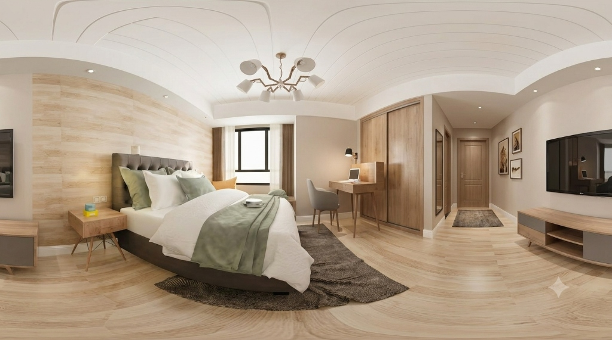

# 🌐 360° Panorama Viewer

> **Ultra-lightweight, hardware-accelerated WebGL 360° equirectangular panorama viewer with zero external 3D libraries, smooth inertia controls, and instant drag-and-drop support.**

[](https://www.khronos.org/webgl/)
[](LICENSE)
[](#technical-architecture)
[](#performance--benchmarks)
[](#key-features)

---

## 📖 Overview

**360° Panorama Viewer** is a standalone, browser-based viewer designed to render high-resolution 360° equirectangular panoramas directly on the GPU. Unlike traditional panorama players that bundle heavy engines like Three.js, Babylon.js, or Pannellum (often exceeding 500KB–2MB), this viewer evaluates spherical projection ray-casting inside a custom, highly optimized **GLSL fragment shader**.

The entire engine runs as a single self-contained HTML file under **35 KB**, requires zero compilation or build tools, loads instantly, and runs completely client-side in private browser memory.



---

## 🌟 Why It’s Useful to Everyone

Whether for professional workflows, creative arts, or everyday memories, this viewer bridges the gap between raw panoramic images and immersive interactive exploration without requiring expensive VR hardware or proprietary software subscriptions.

### 🏢 Real Estate & Property Management
* **Virtual Open Houses:** Real estate brokers and landlords can host 360° virtual home tours for clients on any device with zero monthly fees (bypassing expensive SaaS subscriptions like Matterport or CloudPano).
* **Airbnb & Hospitality:** Showcase hotel suites, vacation rentals, and resort amenities with an engaging 360° view that increases booking conversions.

### 📐 Architects & Interior Designers
* **CGI Renders Showcase:** Render 360° equirectangular cameras directly out of **Blender, 3ds Max, V-Ray, Corona, SketchUp, Lumion, or Twinmotion** and hand a simple link or file to clients so they can stand "inside" their unbuilt space.
* **Before / After Renovation:** Compare spatial layouts, lighting design, and material finishes from the perspective of an occupant.

### 📸 Photographers & Content Creators
* **Hardware Viewer:** Instantly inspect and verify shots from consumer and professional 360° cameras like **Insta360 (X3/X4/One RS), Ricoh Theta (Z1/X), GoPro MAX, Kandao Obsidian**, or DSLR panoramic stitch rigs (PTGui / Hugin).
* **Client Delivery:** Deliver immersive 360° photography packages directly to clients as a standalone offline file.

### 🛸 Drone Pilots & Aerial Surveyors
* **Aerial Panoramas:** View 360° aerial spherical panoramas captured by **DJI Mavic, Phantom, Air, Mini, and Inspire** drones to survey landscapes, construction sites, and agricultural acreage.

### 🎨 AI Artists & Prompt Engineers
* **Generative World Exploration:** Test and immerse yourself in 360° AI-generated environments generated via **Blockade Labs (Skybox AI), Midjourney (v6 panoramas), Stable Diffusion (Equirectangular LoRAs), and DALL-E**.

### 🎮 Game Developers & VFX Artists
* **HDRI & Skybox Inspection:** Inspect high-dynamic-range environment maps (HDRI / EXR converted to JPG/PNG), reflection probes, and background skyboxes in real-time before baking them into Unreal Engine, Unity, or Godot.

### 🏛️ Virtual Tourism, Museums & Education
* **Cultural Preservation:** Bring remote students, researchers, and tourists into historical landmarks, natural wonders, and museum exhibitions.
* **Interactive Classrooms:** Explore geography, planetary surfaces (Mars Rover 360 mosaics), and ocean depths in interactive science courses.

### 🧑‍💻 Everyday Enthusiasts & Travelers
* **Preserving Travel Memories:** Relive vacation panoramas from your smartphone or action camera with natural 360° motion.
* **100% Private & Secure:** Works completely offline without uploading sensitive personal photos to third-party cloud servers.

---

## ✨ Key Features

| Feature | Description |
| :--- | :--- |
| **Pure Hardware Acceleration** | Raw WebGL shader pipeline executing mathematical ray-to-sphere UV transformations on the GPU at 60–144+ FPS. |
| **Zero Heavy 3D Dependencies** | No Three.js, Babylon.js, or A-Frame. Built purely with native WebGL 1.0/2.0 API calls. |
| **Complete Privacy (Client-Side Only)** | Images loaded via drag-and-drop or file picker are read via `FileReader` directly into GPU texture memory. **No data is ever uploaded to a server.** |
| **Smooth Inertial Physics** | Smooth drag-and-pan controls with natural momentum deceleration and damping for a fluid touch/mouse experience. |
| **Full Touch & Gesture Support** | Responsive single-touch pan and multi-touch pinch-to-zoom for iOS (iPhone/iPad) and Android devices. |
| **Dynamic Zoom & FOV** | Continuously variable Field of View from wide-angle **120°** to telescopic **30°** with live FOV telemetry. |
| **Auto-Rotate Mode** | Elegant idle orbit that automatically pauses when interacting and resumes smoothly. |
| **Instant Drag-and-Drop** | Drop any equirectangular JPG, PNG, or WebP file anywhere onto the browser window to instantly load it. |
| **Procedural Canvas Demo** | Built-in 2048×1024 procedural twilight city & starlit galaxy generator created entirely via HTML5 Canvas (runs with zero assets). |
| **Pre-Bundled Sample** | Ships with a sample modern interior room photo to test immediately. |
| **Glassmorphic Minimal UI** | Floating dark-mode control bar with resolution readout, reset button, file switcher, and fullscreen mode. |

---

## 🎮 Controls & Shortcuts

| Action | Mouse | Touch | Keyboard |
| :--- | :--- | :--- | :--- |
| **Look Around (Pan/Tilt)** | Click + Drag | Single Finger Drag | <kbd>W</kbd> <kbd>A</kbd> <kbd>S</kbd> <kbd>D</kbd> or <kbd>↑</kbd> <kbd>←</kbd> <kbd>↓</kbd> <kbd>→</kbd> |
| **Zoom In** | Scroll Wheel Up | Pinch Out (2 fingers) | <kbd>+</kbd> or <kbd>=</kbd> |
| **Zoom Out** | Scroll Wheel Down | Pinch In (2 fingers) | <kbd>-</kbd> or <kbd>_</kbd> |
| **Reset View** | Click Reset Button | Tap Reset Button | <kbd>R</kbd> |
| **Toggle Fullscreen** | Click Fullscreen Button | Tap Fullscreen Button | <kbd>F</kbd> |
| **Load New Image** | Click "Upload" or Drag & Drop | Tap "New Image" icon | — |

---

## 🚀 Getting Started

### 1. Direct Browser Opening (No Setup Required)
Simply double-click `index.html` or `360-viewer.html` in your file explorer. It opens in Google Chrome, Microsoft Edge, Mozilla Firefox, Safari, or Brave immediately.

### 2. Local HTTP Server (Recommended for Development)
Running a local web server ensures seamless loading of local sample assets:

```bash
# Using Python 3
python -m http.server 8000

# Using Node.js npx
npx serve .

# Using PHP
php -S localhost:8000
```
Then navigate to `http://localhost:8000` in your browser.

---

## 📐 Equirectangular Image Guidelines

For the best visual quality and spherical projection accuracy, use images matching standard equirectangular conventions:

* **Aspect Ratio:** Strictly **2:1** (Width = $2 \times \text{Height}$).
* **Coverage:** $360^\circ$ Horizontal $\times$ $180^\circ$ Vertical.
* **Recommended Resolutions:**
  * **2048 × 1024** — Fast loading, ideal for mobile devices & cellular connections.
  * **4096 × 2048 (4K)** — Optimal balance between high clarity and GPU memory footprint.
  * **8192 × 4096 (8K)** — Ultra-sharp high fidelity for desktop monitors and VR displays.
* **Supported File Formats:** `.jpg`, `.jpeg`, `.png`, `.webp`.

---

## 🔬 Technical Architecture & Math

### Fragment Shader Spherical Mapping
Instead of subdividing a 3D sphere into tens of thousands of polygonal vertices, the viewer draws a single 2-triangle screen-space quad ($[-1, 1]$ in Normalized Device Coordinates).

For every screen pixel, the fragment shader computes the camera ray direction vector $\vec{D}$ based on the current Field of View ($FOV$), aspect ratio, camera pitch ($\theta$), and camera yaw ($\phi$):

$$\vec{D}_{\text{camera}} = \text{normalize}\left(\begin{bmatrix} x_{\text{ndc}} \cdot \tan\left(\frac{FOV}{2}\right) \cdot \text{Aspect} \\ y_{\text{ndc}} \cdot \tan\left(\frac{FOV}{2}\right) \\ -1 \end{bmatrix}\right)$$

Applying 3D rotation transformations around the X-axis (Pitch) and Y-axis (Yaw):

$$\vec{D} = R_y(\text{yaw}) \cdot R_x(\text{pitch}) \cdot \vec{D}_{\text{camera}}$$

The 3D direction vector is then converted to spherical longitude ($\lambda$) and latitude ($\varphi$):

$$\lambda = \text{atan2}(D_x, -D_z), \quad \varphi = \arcsin\left(\text{clamp}(D_y, -1.0, 1.0)\right)$$

Finally, spherical coordinates are normalized to equirectangular 2D texture coordinates $(u, v) \in [0, 1]^2$:

$$u = \frac{\lambda}{2\pi} + 0.5, \quad v = \frac{\varphi}{\pi} + 0.5$$

This per-pixel calculation eliminates all polygon seams, edge distortions, and pole pinching, delivering pixel-perfect clarity with zero vertex overhead.

---

## 🌐 Browser Compatibility

| Browser | Supported Platforms | Status |
| :--- | :--- | :--- |
| **Google Chrome** | Windows, macOS, Linux, Android | ✅ Full Support (Hardware Accelerated) |
| **Microsoft Edge** | Windows, macOS | ✅ Full Support |
| **Mozilla Firefox** | Windows, macOS, Linux, Android | ✅ Full Support |
| **Apple Safari** | macOS, iOS, iPadOS | ✅ Full Support (WebGL 1.0 / 2.0) |
| **Brave / Opera / Vivaldi** | Desktop & Mobile | ✅ Full Support |

---

## 📁 Repository Structure

```
360-viewer/
├── .github/
│   └── workflows/
│       └── deploy.yml      # Automated GitHub Pages CI/CD workflow
├── index.html              # Main standalone viewer application
├── 360-viewer.html         # Duplicate standalone entrypoint
├── sample.jpg              # High-resolution sample equirectangular panorama
├── .gitignore              # Git ignore rules
├── LICENSE                 # MIT License
└── README.md               # Documentation and guide
```

---

## 📄 License

This project is open-source and released under the [MIT License](LICENSE). Feel free to use, modify, distribute, and integrate it into commercial or personal projects.

---

<p align="center">Made with ❤️ for high-performance 3D web experiences.</p>
